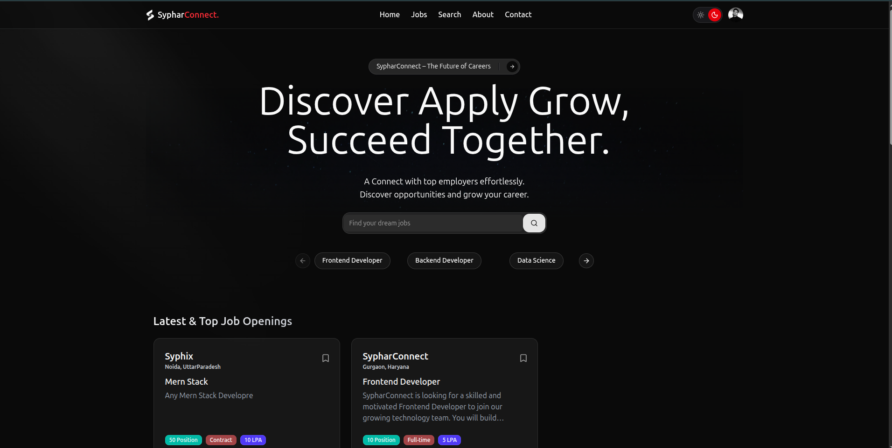

<div align="center">

# SypharConnect

**A modern job-hunt platform that connects job seekers and recruiters.**

Find jobs, apply in a click, track every application, post openings and review applicants, all in one place.



</div>

---

## Table of contents

- [About the project](#about-the-project)
- [Features](#features)
- [Tech stack](#tech-stack)
- [Project structure](#project-structure)
- [Getting started](#getting-started)
- [Environment variables](#environment-variables)
- [Available scripts](#available-scripts)
- [Application routes](#application-routes)
- [API overview](#api-overview)
- [File uploads](#file-uploads)
- [Security notes](#security-notes)
- [Deployment](#deployment)
- [Known limitations](#known-limitations)
- [Author](#author)

## About the project

SypharConnect is a full-stack MERN job portal with two kinds of accounts:

- **Job seekers (students)** search and filter jobs, save the ones they like, apply with their resume and follow the status of each application.
- **Recruiters** register their companies, publish job postings with a rich-text description, and review, accept or reject applicants from a dashboard.

The app has a first-visit onboarding flow, light and dark themes, and a responsive layout that works from phones to wide desktops.

## Features

### For job seekers

- **Onboarding** shown once per device, then straight to sign-up or login.
- **Job listings** with multi-select filters: location, job type, role and salary range.
- **Search page** to find jobs by role, one or more cities (type your own too) and years of experience.
- **Save for later** bookmarks, listed on the profile page.
- **One-click apply.** If no resume is on file, the app asks for one first, then applies.
- **Applied Jobs page** with a status summary (pending, accepted, rejected) and a table of applications.
- **Profile** with a cover banner, photo, bio, skills and resume; photos go through a LinkedIn-style **crop editor** (zoom and straighten).

### For recruiters

- **Company management:** register a company, upload a logo, edit its details.
- **Post a job** with a rich-text editor (headings, bold, lists, quotes), a job-type dropdown, experience, salary in LPA, positions and requirements as tags.
- **Applicants dashboard:** per-job applicant counts, a navbar badge with the number still waiting for a decision, and a side panel with each applicant's contact details, bio, skills and resume.
- **Accept or reject** applicants; the badge and status update immediately.

### Across the app

- Light and dark themes with a toggle (no "system" mode).
- JWT authentication in an HTTP cookie, with automatic sign-out when a session expires.
- Role-aware navigation, logo and footer.
- Sanitised rich text, ownership checks on the server, and file-type and size limits on uploads.

## Tech stack

**Client** (`/client`)

| Area | Technology |
| --- | --- |
| Framework | React 19, TypeScript, Vite 7 |
| Styling | Tailwind CSS 4, shadcn/ui (Radix UI), Tailwind Typography, `tw-animate-css` |
| State | Redux Toolkit, redux-persist |
| Routing | React Router 7 |
| Data and forms | Axios, TanStack Table |
| Rich text | Tiptap 3, DOMPurify |
| Images | react-easy-crop |
| UI extras | lucide-react, Sonner (toasts), Motion (animations) |

**Backend** (`/backend`)

| Area | Technology |
| --- | --- |
| Runtime and framework | Node.js, Express 5 (ES modules) |
| Database | MongoDB with Mongoose 8 |
| Auth | JSON Web Tokens in cookies, bcryptjs |
| Uploads | Multer (disk storage) |
| Security | sanitize-html, CORS with credentials |
| Tooling | Nodemon |

## Project structure

```
syphar-connect/
├── backend/
│   ├── index.js              # Express app and server entry point
│   ├── .env.sample           # Environment variable template
│   └── src/
│       ├── config/           # Reads UPLOAD_DIR / BASE_URL
│       ├── controllers/      # user, company, job, application logic
│       ├── middlewares/      # auth check, upload handling
│       ├── models/           # Mongoose models
│       ├── routes/           # API routes
│       └── utils/            # db connection, uploads, HTML sanitising
├── client/
│   └── src/
│       ├── admin/            # recruiter screens (companies, jobs, applicants)
│       ├── auth/             # login and signup
│       ├── components/       # navbar, footer, shared UI
│       ├── hooks/            # data-fetching and behaviour hooks
│       ├── pages/            # home, jobs, search, profile, legal, ...
│       ├── redux/            # store, slices and types
│       ├── routes/           # route guards
│       └── shared/           # reusable pieces (editor, crop dialog, ...)
├── docs/screenshots/         # images used in this README
└── uploads/                  # created at runtime, git-ignored
```

## Getting started

### Prerequisites

- [Node.js](https://nodejs.org/) 20 or newer, and npm
- A MongoDB database, either local (`mongod`) or [MongoDB Atlas](https://www.mongodb.com/atlas)

### 1. Clone and install

```bash
git clone git@github.com:xshshahab/syphar-connect.git
cd syphar-connect

cd backend && npm install
cd ../client && npm install
```

### 2. Configure the backend

```bash
cd backend
cp .env.sample .env
```

Then edit `backend/.env` (see [Environment variables](#environment-variables)). The `.env` file is git-ignored and must never be committed.

### 3. Run the app

Use two terminals:

```bash
# Terminal 1: API on http://localhost:8080
cd backend
npm run dev

# Terminal 2: client on http://localhost:5173
cd client
npm run dev
```

Open <http://localhost:5173>.

> The backend only accepts requests from `http://localhost:5173` (see `corsOptions` in `backend/index.js`), and the client calls the API at `http://localhost:8080` (see `client/src/utils/constant.ts`). If you change a port or host, update both.

## Environment variables

Set these in `backend/.env`:

| Variable | Description |
| --- | --- |
| `MONGO_URI` | MongoDB connection string, e.g. `mongodb://127.0.0.1:27017/syphar-connect` |
| `SECRET_KEY` | Secret used to sign JWTs. Use a long random value. |
| `PORT` | API port (default `8080`; the client expects `8080`). |
| `UPLOAD_DIR` | Folder for uploaded files: an absolute path, or relative to `backend/`. Use `../uploads` in development and a persistent path in production, e.g. `/var/data/syphar-uploads`. |
| `BASE_URL` | Optional. Public URL of the API, used in links to uploaded files. Defaults to the request host. |

## Available scripts

**Backend** (`/backend`)

| Command | Description |
| --- | --- |
| `npm run dev` | Start the API with Nodemon (auto-reload) |

**Client** (`/client`)

| Command | Description |
| --- | --- |
| `npm run dev` | Start the Vite dev server |
| `npm run build` | Type-check and build for production |
| `npm run preview` | Preview the production build |
| `npm run lint` | Run ESLint |

## Application routes

| Route | Who | Page |
| --- | --- | --- |
| `/welcome` | Everyone | First-visit onboarding |
| `/auth/login`, `/auth/signup` | Guests | Authentication |
| `/` | Logged in | Home |
| `/jobs`, `/search`, `/description/:id` | Logged in | Browse, search and view jobs |
| `/profile` | Logged in | Profile (students: saved jobs; recruiters: activity) |
| `/applied-jobs` | Students | Applied jobs and statuses |
| `/admin/companies`, `/admin/companies/register-company`, `/admin/companies/:id` | Recruiters | Company management |
| `/admin/ad-jobs`, `/admin/ad-jobs/post-job`, `/admin/ad-jobs/:id/applicants` | Recruiters | Job management and applicants |
| `/admin/applicants` | Recruiters | Applicants overview |
| `/about`, `/contact`, `/privacy`, `/terms` | Everyone | Information pages |

## API overview

All endpoints except register, login and logout require the JWT cookie.

| Base path | Endpoints |
| --- | --- |
| `/api/auth/user` | `POST /register`, `POST /login`, `GET /logout`, `PUT /profile/update-profile/:id`, `GET /fetch-all-users` |
| `/api/v1` (companies) | `POST /register-company`, `GET /companies`, `GET /company/:id`, `PUT /company/update-company/:id`, `DELETE /company/delete/:id` |
| `/api/job` | `POST /create-job`, `GET /all-job`, `GET /fetch-by-id/:id`, `GET /admin-job`, `GET /saved`, `POST` and `DELETE /save/:id` |
| `/api/application` | `GET /apply/:id`, `GET /applied-job`, `GET /applicants/:id`, `POST /update-status/:id` |

`GET /api/job/all-job` accepts these query parameters:

- `keyword`: free-text match on title and description.
- `location`, `jobType`, `industry` (role), `salary`: repeat a parameter to select several values. Values within one parameter are OR-ed, different parameters are AND-ed. `salary` takes ranges such as `6-10` or `20+` (LPA).
- `experience`: years of experience; returns jobs asking for that many years or fewer.

## File uploads

Profile photos, company logos and resumes are saved to the folder set in `UPLOAD_DIR` and served from `/uploads/<filename>`.

- Allowed types: JPG, PNG, WEBP, GIF and PDF.
- Maximum size: 5 MB.
- Files get random names.
- The `uploads/` folder is git-ignored, so uploaded files are never committed.

## Security notes

- Passwords are hashed with bcrypt and never sent back to the client.
- Recruiters can only view or change their own companies, jobs and applicants; the server enforces this.
- Job descriptions are sanitised with an allow-list on the server and again when shown.
- Search keywords are escaped before being used in database queries.
- `.env` files are git-ignored. Keep real secrets only in your local `.env` or your host's environment settings.

## Deployment

- **Client:** deploy `client/` to any static host (for example Vercel). Build command `npm run build`, output directory `dist`. Add a rewrite to `index.html` so React Router deep links work, and point the API address in `client/src/utils/constant.ts` at your backend.
- **Backend:** needs Node.js and MongoDB. Uploaded files are stored on disk, so host the API somewhere with a persistent disk (a VPS, or Render/Railway with a volume) and set `UPLOAD_DIR` to that location. Serverless hosts such as Vercel cannot keep these files.
- Set `MONGO_URI`, `SECRET_KEY`, `UPLOAD_DIR` and `BASE_URL` in the host's environment, and update the allowed origin in `backend/index.js` to your client's URL. For a client and API on different domains, the login cookie also needs `SameSite=None; Secure`.

## Known limitations

- The Contact form shows a thank-you message but does not send the message anywhere yet.
- The Privacy Policy and Terms of Service are general template text; have them reviewed before launch.
- API addresses and the CORS origin are hardcoded for local development.
- There is no automated test suite yet.

## Author

**Md. Shahabuddin**

- LinkedIn: <https://www.linkedin.com/in/mdshahabuddin82/>
- X: <https://x.com/imdshahab82>
- Instagram: <https://www.instagram.com/imdshahab.82>

Licensed under the ISC license.
